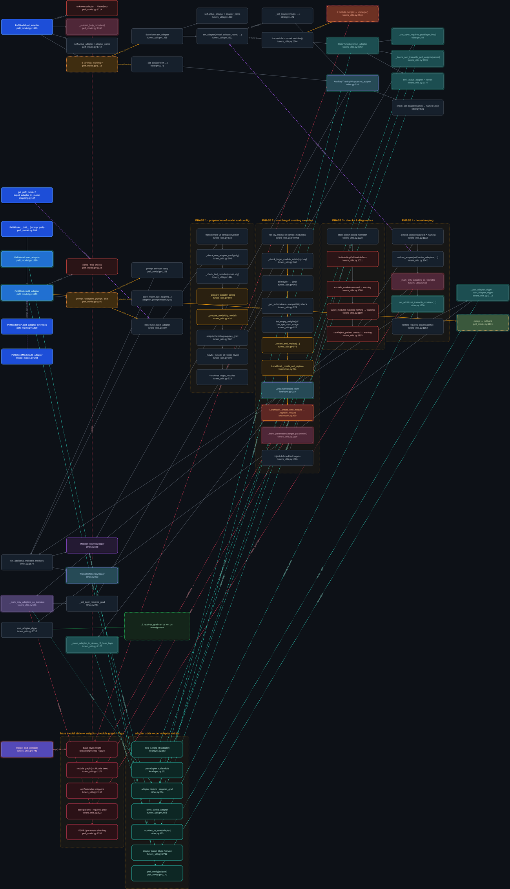
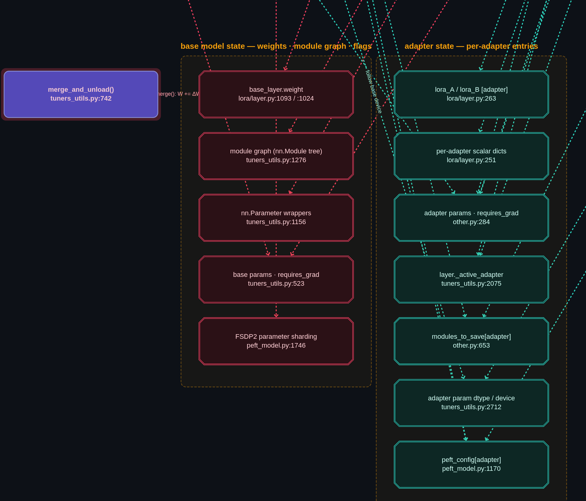

# PEFT adapter flow graph

An interactive, browsable call-flow graph for the two adapter entry points in
[`huggingface/peft`](https://github.com/huggingface/peft):

* `PeftModel.set_adapter` → `BaseTuner.set_adapter` → `BaseTunerLayer.set_adapter`
* `PeftModel.add_adapter` → `BaseTuner.inject_adapter` (4 phases) → `cast_adapter_dtype`

Everything in the graph was read out of the actual source at
`huggingface/peft@91ca7945` (= `origin/main` when this was written). Line numbers
match that commit; every node carries a clickable GitHub link.



## Running it from this checkout

The directory is self-contained — no server, no network, no build step:

```bash
xdg-open tools/adapter-flow-graph/index.html     # or double-click it
```

Base commit of this branch is `91ca7945`, i.e. exactly the commit the line
references were taken from, so the `file:line` on every node matches the sources
in this very checkout. `vendor/` holds a pinned copy of Cytoscape.js (see
`vendor/README.md`).

## Open it

Just open the file — no server and no network needed:

```
xdg-open ~/peft_flow/index.html      # or: open index.html / double-click it
```

A local server also works if you prefer:

```
cd ~/peft_flow && python3 -m http.server 8777   # then http://127.0.0.1:8777/
```

## Reading order

The graph is layered into **columns** (one column per call depth) and **three
swimlanes** (one per flow), so it reads left→right rather than as a hairball:

| lane | what it covers |
|---|---|
| `set_adapter` | switching the active adapter(s), down to the per-layer `_active_adapter` |
| `add_adapter` | injecting a new adapter — PREP → MATCH & CREATE → CHECKS → HOUSEKEEPING |
| shared | auxiliary wrappers, `_mark_only_adapters_as_trainable`, dtype casting |
| model state | **what actually gets mutated** — base model on the left, adapter entries on the right |

The two flows meet in exactly one place: `inject_adapter` finishes by calling
`set_adapter` again (`tuners_utils.py:1142`) — that link is drawn as a purple
**cross-flow** edge.

## State mutation



A **halo** around a node means that call mutates state. Mutation edges are dashed
and coloured by *what* they change: **red = base model**, **teal = per-adapter
entries**. The bottom lane holds the targets, so you can read either direction:
click a call to see what it mutates, click a target to see everything that writes
it.

| target | written by |
|---|---|
| `base_layer.weight` | `unmerge()` → `weight.data -= ΔW` (`lora/layer.py:1108`), `merge()` → `+= ΔW` (`:1080`). **`set_adapter` unmerges any layer that is already merged**, so switching adapters can rewrite real base weights. |
| `module graph` | `_replace_module` → `setattr(parent, child_name, new_module)` (`tuners_utils.py:1276`). The original weight tensor is *shared*, not copied. |
| `nn.Parameter wrappers` | `_inject_parameters` → `lora.ParamWrapper` parametrization for `target_parameters` |
| `base params · requires_grad` | `_mark_only_adapters_as_trainable` → `p.requires_grad = False` (`tuners_utils.py:523`) |
| `FSDP2 parameter sharding` | `_reshard_fsdp_modules()` (`peft_model.py:1746`) — replaces the unsharded params |
| `lora_A / lora_B [adapter]` | `update_layer` → `lora_A[name] = nn.Linear(...)` (`lora/layer.py:263`) — the "add to the param dict" step |
| `per-adapter scalar dicts` | same call: `r`, `lora_alpha`, `scaling`, `lora_dropout`, `lora_bias`, `use_rslora`, `use_dora`, `lora_variant` |
| `adapter params · requires_grad` | `_set_layer_requires_grad` (`other.py:284`), then `_freeze_non_trainable_peft_weights` |
| `layer._active_adapter` | `BaseTunerLayer.set_adapter` (`tuners_utils.py:2075`), and the wrapper's own switch (`other.py:541`) |
| `modules_to_save[adapter]` | `ModulesToSaveWrapper.update` → `deepcopy` per adapter (`other.py:653`); `TrainableTokens` → `trainable_tokens_delta[name]` |
| `adapter param dtype / device` | `cast_adapter_dtype` upcast to fp32, `_move_adapter_to_device_of_base_layer` |
| `peft_config[adapter]` | registered by `add_adapter` (`peft_model.py:1170`), deleted again on rollback, `load_adapter` sets `inference_mode` |

The halo marks and the edge colours are **derived** from the `mutate` edges at
runtime, so they can never disagree with the data.

## Semantic zoom

Detail is tied to zoom level, so the same canvas serves as both an overview and a
drill-down:

| zoom | what is shown |
|---|---|
| ≤ 0.55 | level 1 + 2 — entry points, branches, calls (structure only; labels need ~0.6) |
| ≥ 0.55 | + level 3 — guards, warnings, snapshots, phase internals |
| ≥ 1.0 | + level 4 — the LoRA-specific internals (`_create_and_replace`, `update_layer`, `_create_new_module`) |

When lower levels are hidden, the remaining nodes stay connected through dotted
**bridge** edges, so nothing looks truncated. Bridges are computed in *both*
directions (downstream and upstream), which is what keeps mutation targets
attached to their callers at zoomed-out levels. They are derived, never
exported, and the side panel lists them under "via hidden steps".

You can also pin the detail level with the dropdown, or hit **Fit** after
collapsing a lane.

## Deploying as a Hugging Face Space

`build-space.sh` assembles `./space/` — the exact tree to upload. A *static*
Space is just a web root, so `README.md` there carries the Space card
frontmatter (`sdk: static`) and `index.html` is the entry point. Everything is
relative-path and vendored, so the Space needs no network and no build step.

```bash
./build-space.sh          # writes ./space/  (add --clean to empty it first)
./deploy-space.sh         # needs HF_SPACE_TOKEN + optional SPACE_ID
./deploy-space.sh --private
```

`deploy-space.sh` creates the Space with `hf repos create --space-sdk static`
and uploads with `hf upload`. It needs a User Access Token that can **create
repos** and write to the target namespace; the tokens wired into this Hermes
profile (`HF_TOKEN` = `inference-provider-token`, scope `repo.access.read` +
`inference.serverless.write`; `HF_JOBS_TOKEN` = `job.write`) cannot do that.

Verify a build locally by serving the output root (not the parent directory):

```bash
cd space && python3 -m http.server 8788   # then http://127.0.0.1:8788/
```

Note: inside the Space iframe, browser downloads (Export JSON / PNG) may be
blocked by the embedding page — open the Space in its own tab if nothing
downloads.

## Editing

| gesture | effect |
|---|---|
| drag node | move it (positions persist in `localStorage`) |
| click node | open the detail panel: source link, signature, what it does, watch-outs, calls in/out, and your own note field |
| double-click node | focus mode — dim everything outside its 1-hop neighbourhood (Esc to exit) |
| click lane title | collapse / expand that whole swimlane |
| **Connect** mode | drag node→node (or click node, then click target) to draw your own edge |
| **Note** mode | click empty canvas to drop a note node; double-click it to rename |
| Delete | removes things you created; hides baseline elements (restorable) |
| `V` `C` `N` `F` `L` `/` | select / connect / note / fit / re-layout / search |

**Export JSON** writes the full graph — baseline plus your nodes, edges, notes and
positions — as a self-contained snapshot; **Import** reads it back losslessly (this
is the round-trip that has been tested). **PNG** exports the whole graph at 2×.

## Extending the dataset

`graph-data.js` is the single source of truth: a `nodes` array plus an `edges`
array. A node is

```js
{ id, lane, col, row, tier, kind, label, sub, file, line,
  sig, does: [...], watch: [...] }
```

* `col` = call-depth column, `row` = vertical slot inside its lane (floats allowed),
  `tier` = zoom level at which it appears. Layout is computed from those, so you
  only edit content.
* `kind` picks the styling: `entry`, `method`, `tuner`, `layer`, `branch`, `guard`,
  `note`, `band` (phase box).
* edges are `{ s, t, kind, label }` with `kind` ∈ `call`, `branch`, `cross`,
  `note`.

`window.__flow` exposes `cy`, `snapshot()`, `relayout()`, `importSnapshot()` and a
small `api` (`addNode`, `addEdge`, `setNote`) if you want to script the canvas from
the console.
